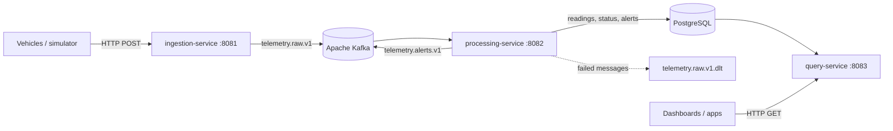

# Vehicle Telemetry Platform

An event-driven backend that ingests real-time telemetry from a fleet of electric vehicles, processes it as a stream, raises alerts and serves the data through REST APIs.

Built with **Kotlin 2.3, Spring Boot 4.1, Java 25, Apache Kafka 4.1 and PostgreSQL 18**, as three independent microservices.



## Features

- **Ingestion API** with validation and RFC 9457 Problem Details errors, single and batch endpoints
- **Kafka streaming** keyed by vehicle id, so each vehicle's readings stay in order
- **Idempotent processing**: duplicate deliveries are detected by event id
- **Out-of-order handling**: late readings never overwrite a vehicle's newer status
- **Alert rules** for low battery, battery overheating, overspeed and diagnostic trouble codes
- **Dead-letter topic** with retries, so one bad message never blocks a partition
- **CQRS-style read side**: a separate query service with plain SQL (`JdbcClient`)
- **Database migrations** with Flyway
- **Virtual threads** (Java 21+) for simple, scalable blocking code
- **Observability**: health probes and Prometheus metrics on every service
- **Fleet simulator** to generate realistic traffic
- **Docker Compose** for the whole stack, **GitHub Actions** CI

## Tech stack

| Area | Technology |
|---|---|
| Language | Kotlin 2.3 on Java 25 (LTS) |
| Framework | Spring Boot 4.1 (Spring Framework 7) |
| Messaging | Apache Kafka 4.1 (KRaft, no ZooKeeper), Spring for Apache Kafka |
| Database | PostgreSQL 18, Spring Data JPA (Hibernate 7) on the write side, JdbcClient on the read side, Flyway |
| Serialization | kotlinx.serialization for events, Jackson 3 for REST |
| Observability | Spring Boot Actuator, Micrometer, Prometheus |
| Build | Gradle 9 (Kotlin DSL, version catalog), multi-module |
| Runtime | Docker, Docker Compose |
| CI | GitHub Actions |
| Tests | JUnit 5/6, AssertJ |

## Project structure

```
vehicle-telemetry-platform/
├── libs/
│   └── telemetry-contracts/      Shared event classes, topic names, JSON codec
├── services/
│   ├── ingestion-service/        REST API -> validates -> publishes to Kafka     (port 8081)
│   ├── processing-service/       Kafka consumer -> PostgreSQL + alert rules      (port 8082)
│   └── query-service/            Read-only REST API over PostgreSQL              (port 8083)
├── tools/
│   └── vehicle-simulator/        Sends realistic telemetry for a fleet of EVs
├── infra/
│   └── prometheus/               Prometheus scrape configuration
├── docs/
│   ├── getting-started.md        Every step to install, run and test
│   ├── architecture.md           Design, data flow, topics, database schema
│   ├── api.md                    REST API reference with examples
│   ├── how-it-works.md           Code walkthrough, file by file
│   └── adr/                      Architecture decision records
├── http/requests.http            Ready-made API calls
├── compose.yaml                  Kafka, PostgreSQL, Kafka UI, Prometheus (+ services)
├── gradle/libs.versions.toml     All dependency versions in one place
└── .github/workflows/ci.yml      Build and test on every push
```

## Quick start

Requirements: **Docker Desktop** and **Git**. Java 25 is downloaded automatically by Gradle if missing.

```bash
# 1. Start Kafka, PostgreSQL, Kafka UI and Prometheus
docker compose up -d

# 2. Build and test everything
./gradlew build

# 3. Start the three services (one terminal each)
./gradlew :services:ingestion-service:bootRun
./gradlew :services:processing-service:bootRun
./gradlew :services:query-service:bootRun

# 4. Send traffic from 5 simulated vehicles
./gradlew :tools:vehicle-simulator:run --args="--vehicles=5"

# 5. Look at the results
curl http://localhost:8083/api/v1/vehicles
```

On Windows use `gradlew.bat` instead of `./gradlew`.

**Full step-by-step instructions, including troubleshooting: [docs/getting-started.md](docs/getting-started.md)**

| URL | What |
|---|---|
| http://localhost:8081/api/v1/telemetry | Ingestion API |
| http://localhost:8083/api/v1/vehicles | Query API |
| http://localhost:8090 | Kafka UI (topics, messages, consumer lag) |
| http://localhost:9090 | Prometheus |
| http://localhost:808x/actuator/health | Health of each service |

## Documentation

- [Getting started](docs/getting-started.md)
- [Architecture](docs/architecture.md)
- [API reference](docs/api.md)
- [How it works: code walkthrough](docs/how-it-works.md)
- [Architecture decisions](docs/adr/)

## License

MIT, see [LICENSE](LICENSE).
