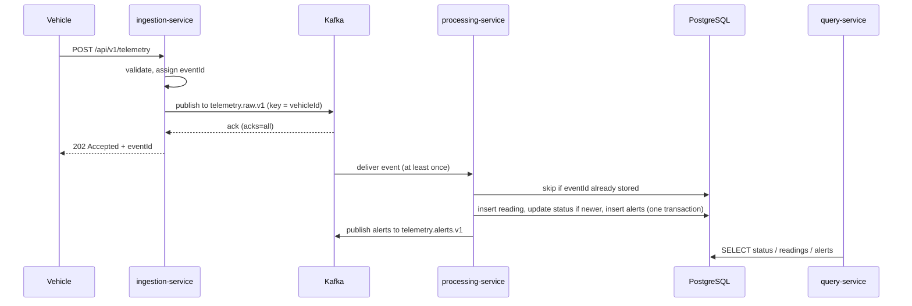
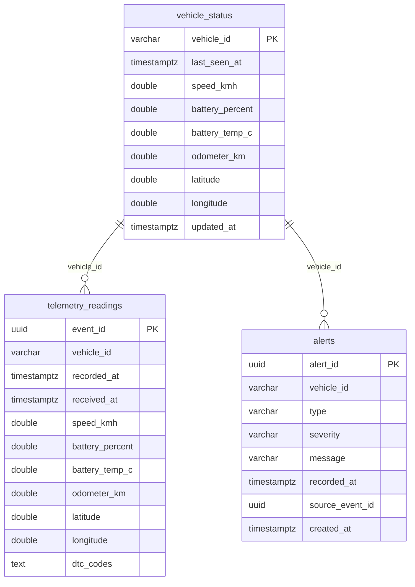

# Architecture

## Goals

1. Accept high-frequency telemetry from many vehicles without losing data.
2. Process readings in order per vehicle, tolerate duplicates and late data.
3. Detect problems (low battery, overheating, overspeed, fault codes) in near real time.
4. Serve current status and history quickly to dashboards and apps.
5. Let each part scale and be deployed independently.

## Services

| Service | Responsibility | Talks to | Port |
|---|---|---|---|
| **ingestion-service** | Validate incoming readings, assign an event id, publish to Kafka | Kafka (producer) | 8081 |
| **processing-service** | Consume readings, store them, maintain latest vehicle status, evaluate alert rules, publish alerts | Kafka (consumer + producer), PostgreSQL (read/write, owns schema) | 8082 |
| **query-service** | Read-only REST API for status, history and alerts | PostgreSQL (read-only) | 8083 |
| **telemetry-contracts** *(library)* | Event classes, topic names, JSON codec shared by all services | – | – |
| **vehicle-simulator** *(tool)* | Generates realistic fleet traffic | ingestion-service (HTTP) | – |

## Data flow

## Kafka topics

| Topic | Key | Partitions | Producer | Consumer |
|---|---|---|---|---|
| `telemetry.raw.v1` | vehicleId | 3 | ingestion-service | processing-service |
| `telemetry.raw.v1.dlt` | vehicleId | 3 | processing-service (error handler) | – (inspect manually) |
| `telemetry.alerts.v1` | vehicleId | 3 | processing-service | future notification service |

- **Keying by vehicle id** sends all readings of one vehicle to the same partition, so they are processed in order.
- **Version suffix** (`.v1`) lets us introduce a breaking event format later without disrupting consumers.
- **Producer settings:** `acks=all` and idempotence enabled, so a 202 response means the event is durably stored and retries create no duplicates in Kafka.

## Reliability

| Situation | Handling |
|---|---|
| Kafka delivers an event twice | `event_id` is the primary key; duplicates are skipped (idempotent consumer) |
| Readings arrive out of order | Vehicle status is only updated if the reading is newer than the stored one |
| Malformed message | Sent straight to the dead-letter topic, no retries |
| Temporary failure (e.g. database restart) | Retried twice, 1 s apart, then sent to the dead-letter topic |
| Kafka unavailable during ingestion | Client receives `503` and can retry; nothing is half-written |

## Database schema

Indexes on `(vehicle_id, recorded_at DESC)` match the main query pattern: one vehicle, recent time range, newest first.

## Alert rules

| Rule | Threshold | Severity |
|---|---|---|
| Low battery | < 15 % | WARNING |
| Low battery | < 5 % | CRITICAL |
| Battery overheating | > 60 °C | CRITICAL |
| Overspeed | > 180 km/h | WARNING |
| Diagnostic trouble code | any code present | WARNING |

Rules live in `AlertRules.kt` as pure functions, so they are easy to test and extend.

## Scaling

- **ingestion-service** is stateless: run more instances behind a load balancer.
- **processing-service** scales with Kafka partitions: up to 3 consumers in the group today; increase partitions to scale further.
- **query-service** is stateless and read-only: run more instances, add PostgreSQL read replicas if needed.
- For very large volumes, `telemetry_readings` can move to TimescaleDB or be partitioned by time without changing the services' APIs.

## Known limitations and next steps

- **Alert publishing after commit:** if Kafka is down at that moment, an alert is stored in the database but not published. The standard fix is the *transactional outbox* pattern (see [ADR 0004](adr/0004-known-trade-offs.md)).
- **Security:** APIs are open for local development. Next step: OAuth2 resource server (JWT) with Spring Security.
- **Notification service:** consume `telemetry.alerts.v1` and send e-mails or push notifications.
- **Integration tests** with Testcontainers (Kafka + PostgreSQL) in CI.
- **Kubernetes** manifests or Helm chart for deployment.
